

<picture>
  <source media="(prefers-color-scheme: dark)" srcset="assets/banner-dark.svg">
  
</picture>

 

<a href="https://raminbakhshaliyev.com"><picture><source media="(prefers-color-scheme: dark)" srcset="assets/pill-site-dark.svg">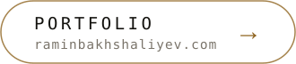</picture></a>
<a href="https://www.linkedin.com/in/raminbakhshaliyev"><picture><source media="(prefers-color-scheme: dark)" srcset="assets/pill-linkedin-dark.svg">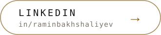</picture></a>
<a href="mailto:raminbakhshaliyev@gmail.com"><picture><source media="(prefers-color-scheme: dark)" srcset="assets/pill-mail-dark.svg"></picture></a>

 

I turn ideas into AI-powered products and automated workflows. I started on iOS apps and fintech products; today my focus is generative AI and coding agents. Currently an iOS developer at FitNest and a Flutter developer at Portmanat.

<picture>
  <source media="(prefers-color-scheme: dark)" srcset="assets/section-work-dark.svg">
  
</picture>

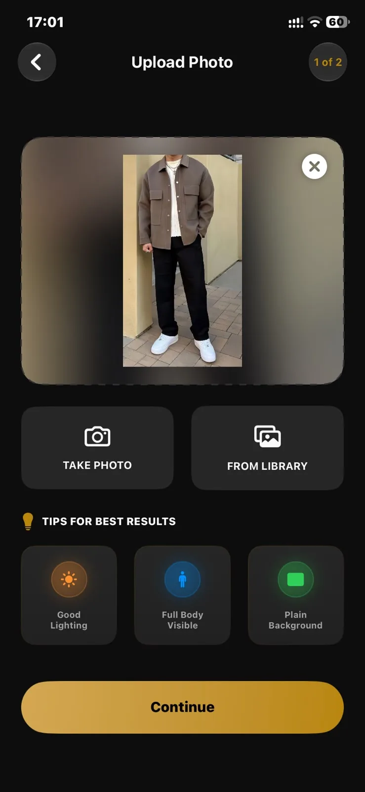
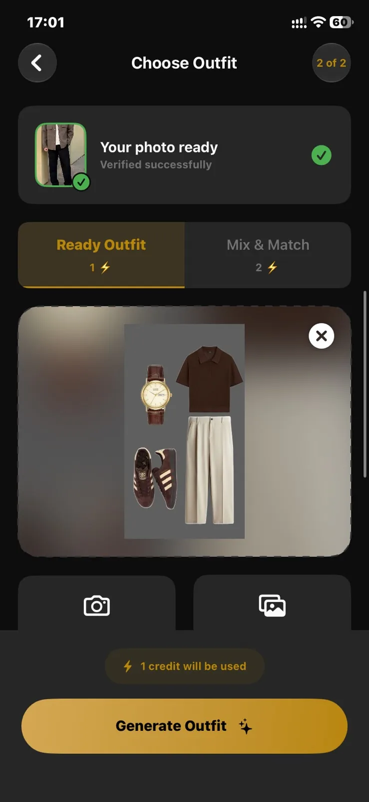
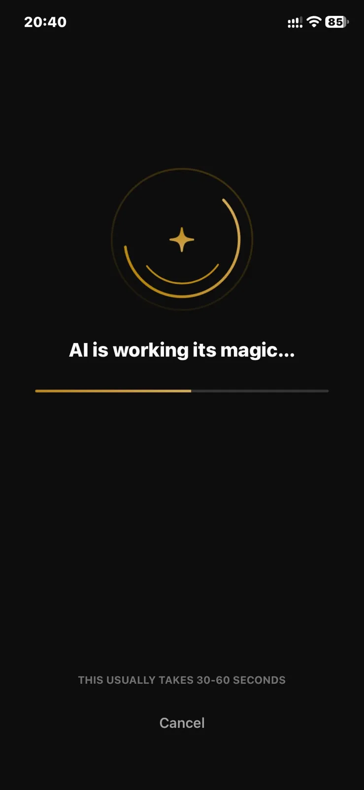
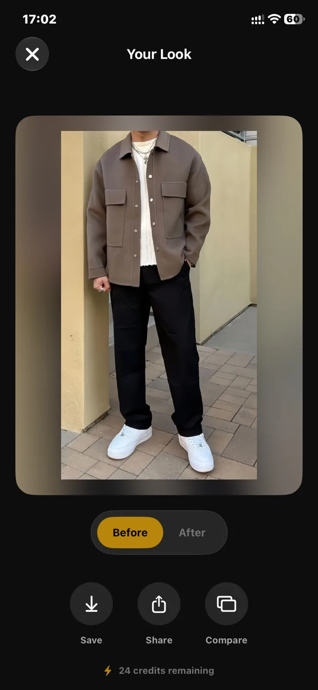
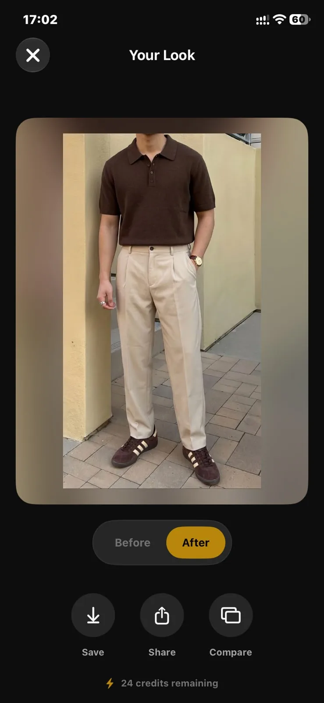
 
<a href="https://apps.apple.com/az/app/mirrorly-ai/id6759640031"><b>Open Mirrorly on the App Store</b></a>

 

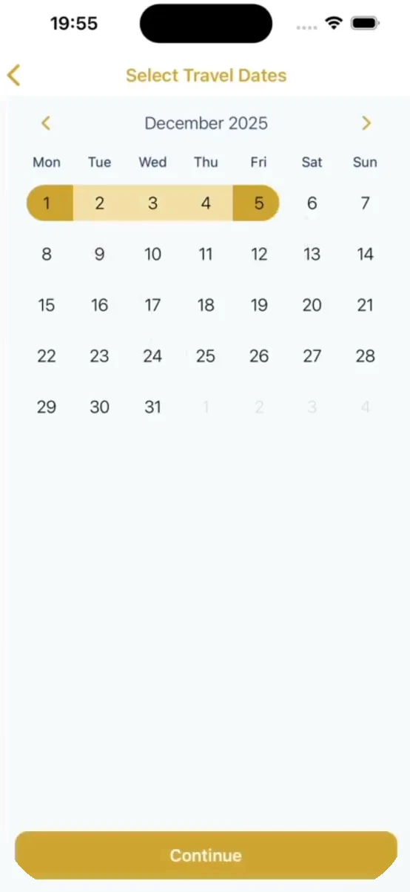
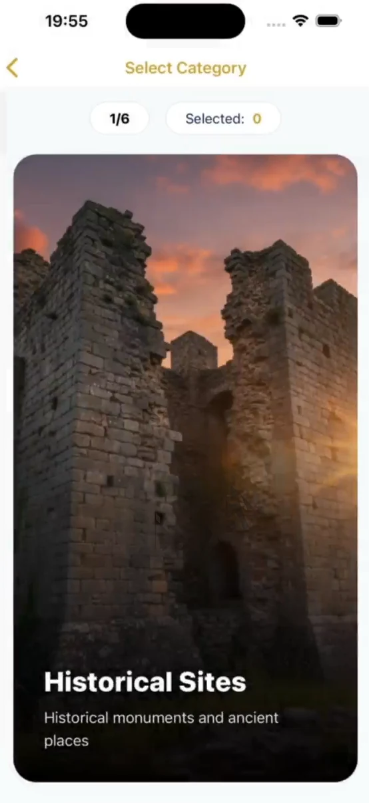
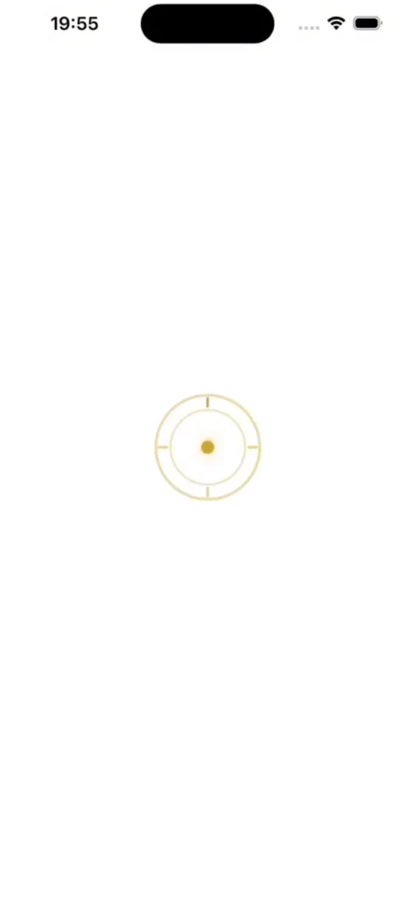
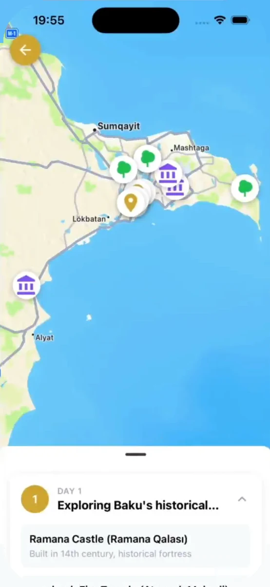
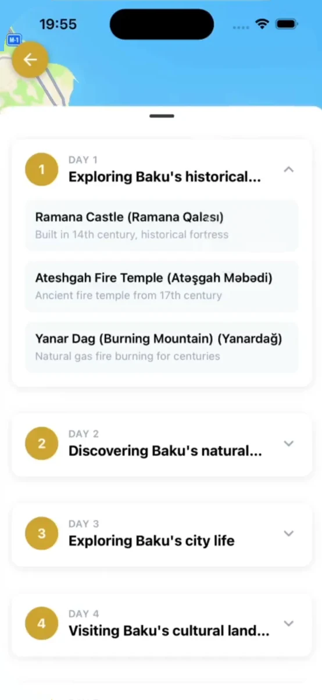

 

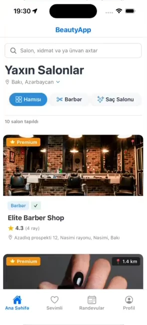
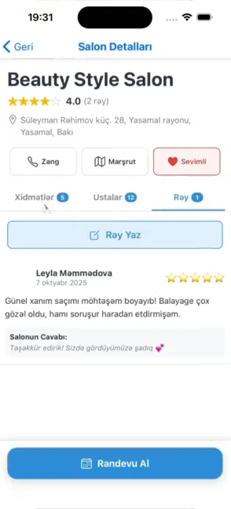
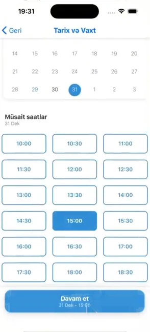
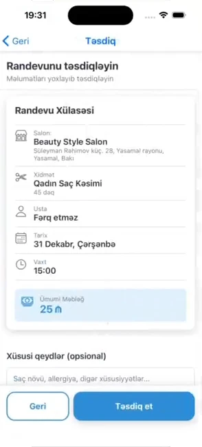
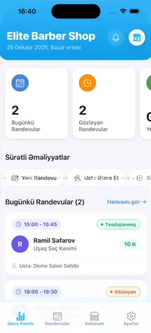

 

<picture>
  <source media="(prefers-color-scheme: dark)" srcset="assets/section-stack-dark.svg">
  
</picture>

<picture>
  <source media="(prefers-color-scheme: dark)" srcset="assets/stack-dark.svg">
  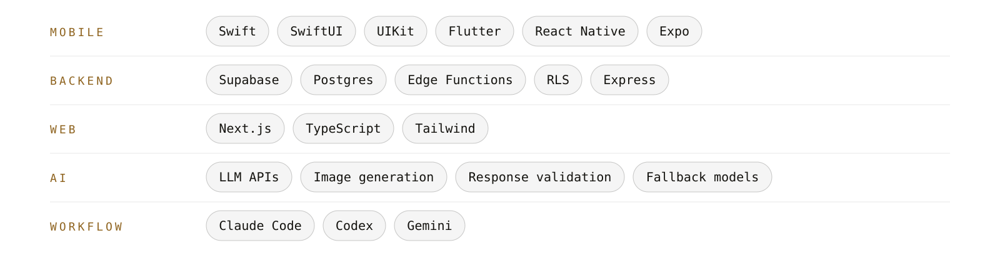
</picture>

 

<picture>
  <source media="(prefers-color-scheme: dark)" srcset="assets/section-method-dark.svg">
  
</picture>

| Signal | System | Build | Ship |
|---|---|---|---|
| **Problem first.** What decision is the user making here? Nothing gets built until that is clear. | **Then the system.** Type, spacing and motion follow one set of rules, so every later feature costs less. | **Agents write, I review.** I set the direction, review every line and own what ships. | **Ship it, then measure.** Done means in users' hands. Then measure, then iterate. |

 

This portfolio is open source: <a href="https://github.com/Ramin7DEV/Ramin-Bakhshal-yev">Ramin7DEV/Ramin-Bakhshal-yev</a>. Engineered in Baku.

